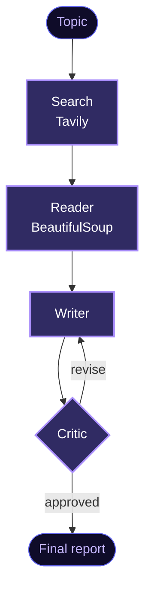
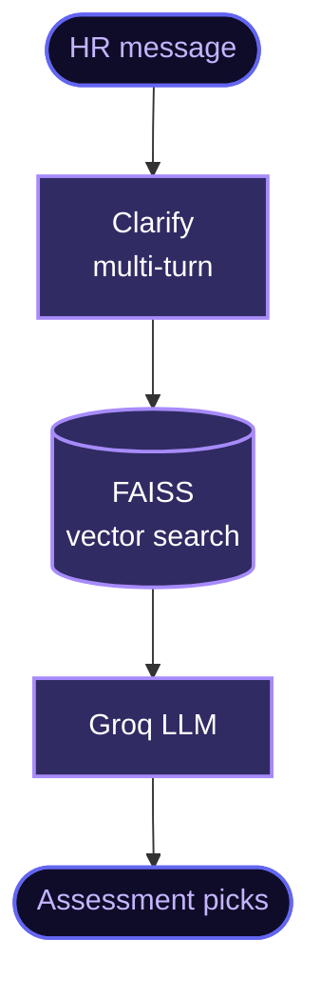

<div align="center">


<br>

[](https://linkedin.com/in/irbaaz-noor)
[](mailto:noorirbaaz@gmail.com)
[](https://irbaaz-multi-agent-ai-research-system.streamlit.app)

</div>

<br>

## 🧠 About Me

```python
class AIEngineer:
    def __init__(self):
        self.name       = "Irbaaz Noor"
        self.location   = "Delhi NCR, India"
        self.role       = "LLM Post-Training @ Ethara AI"
        self.focus      = ["Multi-Agent AI", "RAG Systems", "LLM Evaluation"]
        self.stack      = ["Python", "LangGraph", "FastAPI", "FAISS", "Groq"]
        self.philosophy = "Impactful AI solves real problems for real people."

    def currently(self):
        return {
            "building" : "Agentic pipelines & RAG chatbots",
            "exploring": "Multi-agent orchestration, retrieval, LLM evals",
            "open_to"  : "Collaborations, open-source, exciting AI projects"
        }

me = AIEngineer()
```

<br>

## `~/projects`

<table>
<tr>
<td width="50%" valign="top">

### 🤖 MARS
**Multi-Agent AI Research System**

I built a 4-agent LangGraph pipeline that takes any topic and returns a researched, critiqued report. The Critic keeps sending drafts back until they pass review.

`LangGraph` `LLaMA 3.1` `Groq` `Tavily` `BeautifulSoup` `Streamlit`

[▶ Live demo](https://irbaaz-multi-agent-ai-research-system.streamlit.app) · [{ } Code](https://github.com/IrbaazN/multi-agent-research-system)

</td>
<td width="50%" valign="top">

### 💬 SHL Recommender
**Conversational assessment finder**

I built an AI chatbot that helps HRs find the right SHL assessments through multi-turn conversation, using FAISS vector search and a Groq-hosted LLM.

`FastAPI` `FAISS` `Groq` `Python`

[{ } Code](https://github.com/IrbaazN/SHL-recommender)

</td>
</tr>
</table>

<details>
<summary>🔬 <b>How MARS works</b> (click to expand)</summary>
<br>



</details>

<details>
<summary>🔬 <b>How SHL Recommender works</b> (click to expand)</summary>
<br>



</details>

<br>

## `~/lab` &nbsp;·&nbsp; <sub>smaller experiments</sub>

<details>
<summary>💳 <b>Credit Card Fraud Detection</b></summary>
<br>
I built an XGBoost + SMOTE model for heavily imbalanced transaction data, reaching 97%+ precision.
</details>

<details>
<summary>🩺 <b>Breast Cancer Prediction</b></summary>
<br>
I built a classification model on clinical features.
</details>

<details>
<summary>🎙️ <b>VidSnapAI</b></summary>
<br>
I built a Flask app that generates voiceovers with ElevenLabs.
</details>

<br>

## `~/stack`

<div align="center">


</div>

<br>

<div align="center">

**Let's build something agentic 👇**

[](mailto:noorirbaaz@gmail.com)


</div>
