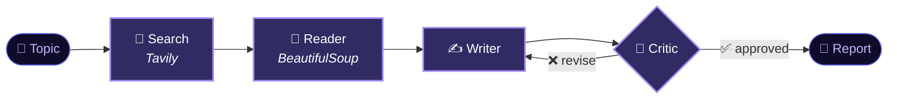
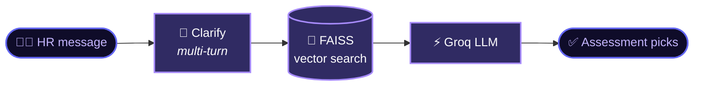

<div align="center">


<br>

[](https://linkedin.com/in/irbaaz-noor)
[](mailto:noorirbaaz@gmail.com)
[](https://irbaaz-multi-agent-ai-research-system.streamlit.app)

</div>

<br>

## `~/about`

```bash
irbaaz@delhi-ncr:~$ cat about.txt

  B.Tech CSE (AI) · Jamia Hamdard University · 2026
  Day job   : LLM post-training @ Ethara AI
  Side quest: building agentic AI systems that fact-check themselves
  Obsessed  : pipelines where one agent's job is to criticise another
  Status    : open to collaborations ✅
```

<br>

## `~/projects`

<table>
<tr>
<td width="50%" valign="top">

### 🤖 MARS
**Multi-Agent AI Research System**

I built a 4-agent LangGraph pipeline that takes any topic and returns a researched, critiqued report. The Critic keeps sending drafts back until they pass review.

`LangGraph` `LLaMA 3.1` `Groq` `Tavily` `BeautifulSoup` `Streamlit`

[▶ Live demo](https://irbaaz-multi-agent-ai-research-system.streamlit.app) · [{ } Code](https://github.com/IrbaazN/multi-agent-research-system)

</td>
<td width="50%" valign="top">

### 💬 SHL Recommender
**Conversational assessment finder**

I built an AI chatbot that helps HRs find the right SHL assessments through multi-turn conversation, using FAISS vector search and a Groq-hosted LLM.

`FastAPI` `FAISS` `Groq` `Python`

[{ } Code](https://github.com/IrbaazN/SHL-recommender)

</td>
</tr>
</table>

### 🔬 Inside MARS



### 🔬 Inside SHL Recommender



<br>

## `~/lab` &nbsp;·&nbsp; <sub>smaller experiments</sub>

<details>
<summary>💳 <b>Credit Card Fraud Detection</b></summary>
<br>
I built an XGBoost + SMOTE model for heavily imbalanced transaction data, reaching 97%+ precision.
</details>

<details>
<summary>🩺 <b>Breast Cancer Prediction</b></summary>
<br>
I built a classification model on clinical features.
</details>

<details>
<summary>🎙️ <b>VidSnapAI</b></summary>
<br>
I built a Flask app that generates voiceovers with ElevenLabs.
</details>

<br>

## `~/stack`

<div align="center">


<br><br>


</div>

<br>

<div align="center">

```text
┌──────────────────────────────────────────────────────────────┐
│  "I like pipelines where the agents argue until it's right." │
└──────────────────────────────────────────────────────────────┘
```

**Let's build something agentic 👇**

[](mailto:noorirbaaz@gmail.com)


</div>
